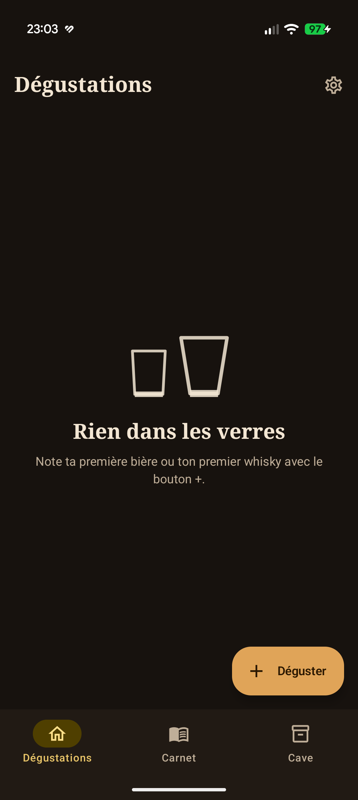
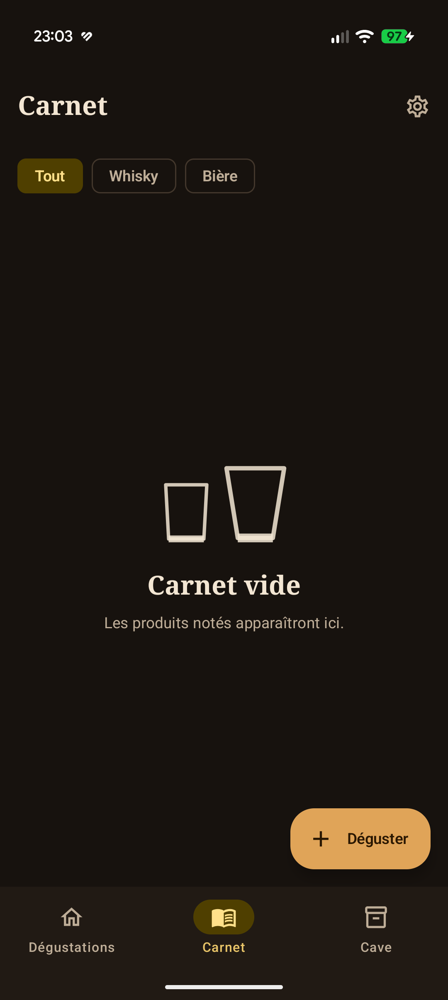
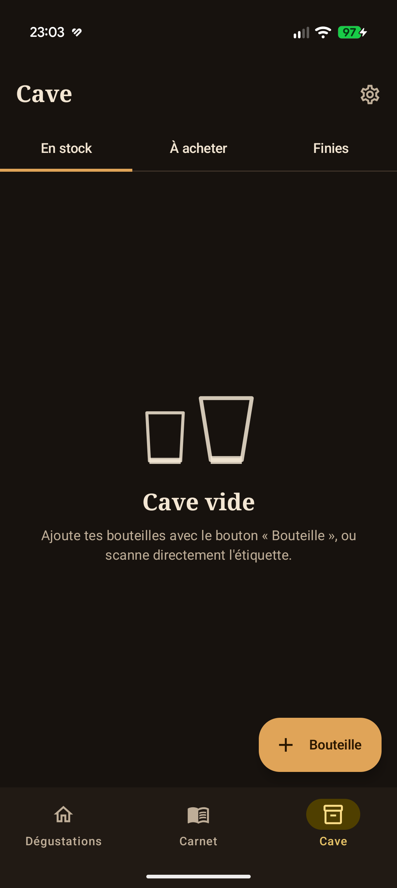
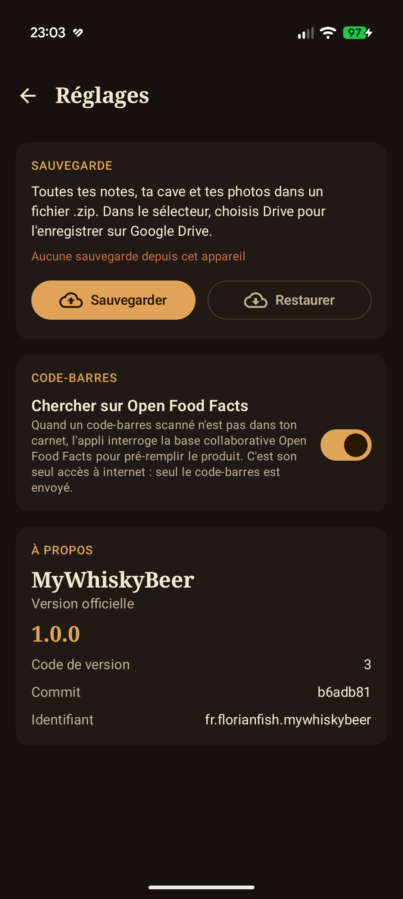

# MyWhiskyBeer

Carnet de dégustation perso — bières & whisky.

Application Android **à usage personnel** pour noter les bières et les whiskies que je goûte, garder une trace de ma cave et retrouver ce que j'ai aimé.

Pas de réseau social, pas de compte : un carnet perso, rapide à remplir, qui fonctionne hors-ligne.

## Aperçu

<table>
  <tr>
    <td align="center"><br><sub>Dégustations</sub></td>
    <td align="center"><br><sub>Carnet</sub></td>
    <td align="center"><br><sub>Cave</sub></td>
    <td align="center"><br><sub>Réglages</sub></td>
  </tr>
</table>

<sub>Version 1.0.0, thème sombre « cave à la lueur » (voir [docs/DESIGN.md](docs/DESIGN.md)).</sub>

## Principes

- **Saisie en moins de 30 secondes** : sinon je ne noterai pas au bar ou en salon.
- **Hors-ligne d'abord** : tout est stocké localement.
- **Un produit ≠ une dégustation** : je peux goûter la même bouteille plusieurs fois et voir l'évolution de mes notes.
- **Tronc commun + champs spécifiques** : bière et whisky partagent l'essentiel, chacun a ses champs propres. Extensible plus tard (rhum, gin, vin…).

## Stack envisagée

| Besoin | Choix |
|---|---|
| Langage / UI | Kotlin + Jetpack Compose (Material 3) |
| Stockage local | Room (SQLite) |
| Photos | CameraX, fichiers dans le stockage privé de l'app |
| Code-barres / OCR étiquette | ML Kit (sur l'appareil, gratuit) |
| Architecture | MVVM, Hilt pour l'injection, Flow/StateFlow |
| Sauvegarde | Export/import JSON + photos (zip), puis éventuellement synchro auto-hébergée |

## Installer

Dernier APK de debug (remplacé à chaque push sur `main`) : [MyWhiskyBeer-debug.apk](https://github.com/florianfish/MyWhiskyBeer/releases/download/debug/MyWhiskyBeer-debug.apk). Il s'installe par-dessus le précédent (clé de debug fixe) et à côté d'une version release.

La CI utilise les workflows partagés de [Forge-Apk](https://github.com/florianfish/Forge-Apk).

## Publier une version

**Depuis le téléphone ou le navigateur** : onglet **Actions** → workflow **Release APK** → **Run workflow** (branche `main`) → choisir le type de version → **Run workflow**. Le workflow prend le dernier tag (ex. `v1.0.0`), calcule le suivant (**mineure** `v1.1.0`, **correctif** `v1.0.1`, **majeure** `v2.0.0`), compile l'APK signé et publie la release `MyWhiskyBeer-vX.Y.Z.apk` avec ses notes.

Autres possibilités : pousser un tag (`git tag v1.1.0 && git push origin v1.1.0` ; il doit commencer par `v`), ou créer une release dans l'interface GitHub avec un nouveau tag `v…` (l'APK y est ajouté).

- Nom de version = tag sans le `v` ; numéro de version (`versionCode`) = numéro d'exécution du workflow, toujours croissant.
- En cas d'échec : **Re-run jobs** sur l'exécution.
- La CI est celle de [Forge-Apk](https://github.com/florianfish/Forge-Apk) (`android-release.yml`).

### Clé de signature

Toutes les releases doivent être signées avec **la même clé**, sinon Android refuse la mise à jour (désinstallation obligatoire, données perdues). La clé (`mywhiskybeer-release.jks`, alias `mywhiskybeer`) et son mot de passe sont conservés hors de GitHub.

Secrets du dépôt (**Settings → Secrets and variables → Actions**) :

| Secret | Valeur |
|---|---|
| `KEYSTORE_BASE64` | le fichier `.jks` encodé en base64, sur une ligne |
| `KEYSTORE_PASSWORD` | mot de passe du keystore |
| `KEY_ALIAS` | `mywhiskybeer` |
| `KEY_PASSWORD` | mot de passe de la clé (le même) |

### Passer de l'appli de debug à la release

Les deux s'installent côte à côte (l'appli de debug a l'identifiant `….debug`) et ont des données séparées. Pour reprendre ses notes : **Réglages → Sauvegarder** dans l'appli de debug, puis **Réglages → Restaurer** dans l'appli release.

## Compiler

Ouvrir le projet dans Android Studio (JDK 17), ou en ligne de commande :

```
./gradlew assembleDebug
./gradlew testDebugUnitTest
```

minSdk 26, targetSdk 35. Le schéma Room est exporté dans `app/schemas/` (à versionner).

## Structure

```
app/src/main/java/fr/florianfish/mywhiskybeer/
├── data/local/        # Room : entités, DAO, base, référentiel d'arômes
├── di/                # Modules Hilt
├── domain/            # Logique métier (échelles de notes…)
└── ui/                # Compose : thème, composants, écrans, navigation
```

## Documentation

- [`docs/PLAN.md`](docs/PLAN.md) — modèle de données, écrans, roadmap par version
- [`docs/FEATURES.md`](docs/FEATURES.md) — idées de fonctionnalités, priorisées
- [`docs/DESIGN.md`](docs/DESIGN.md) — direction visuelle, couleurs, éléments signature
